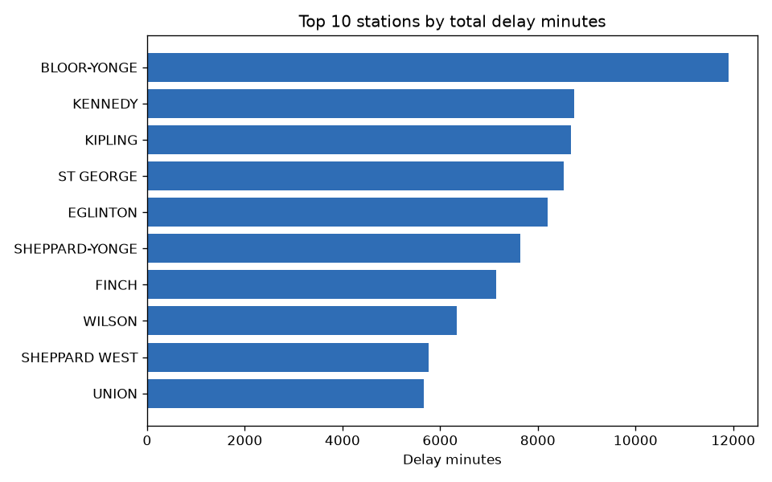
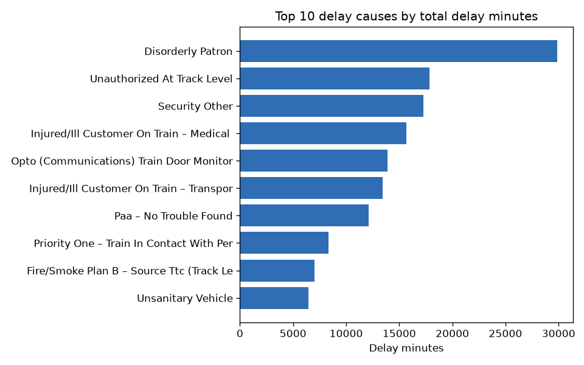
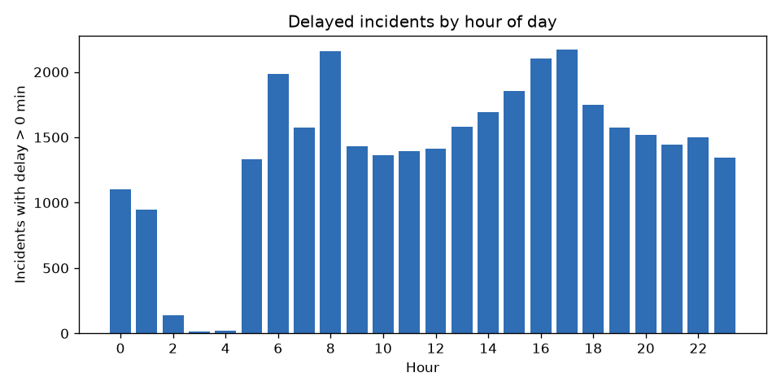
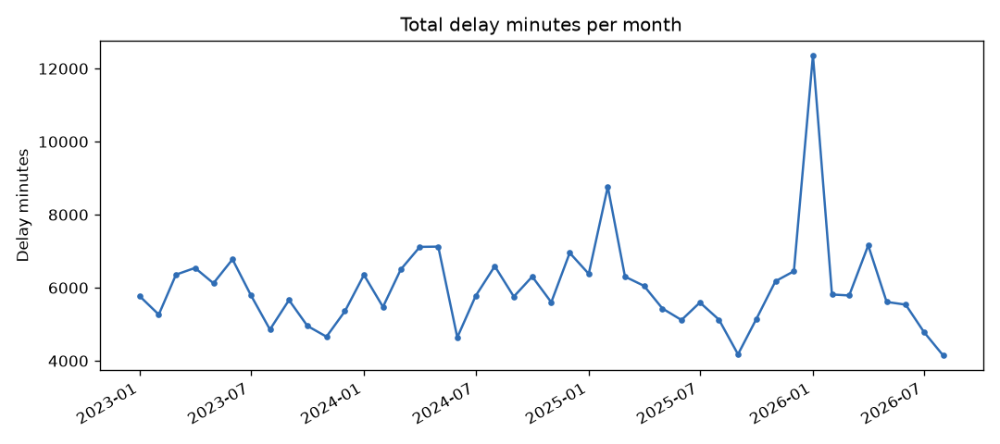

# TTC Subway Delay Data Pipeline


A Python pipeline that downloads Toronto Transit Commission (TTC) subway delay records from the City of Toronto Open Data portal, **cleans and validates** them with explicit data-quality rules, loads them into a **SQLite** database, and calculates delay KPIs with **SQL**. Every cleaning and validation rule is covered by automated **pytest** tests that run on each push through **GitHub Actions**.

**Data:** 94,891 delay records, January 2023 – August 2026 (three source files in two formats).
**Stack:** Python, pandas, SQL (SQLite), pytest, GitHub Actions, matplotlib.

## Key findings

| | |
|---|---|
| **Most logged incidents cause no delay** | Only 35% of incidents (33,419 of 94,512) delayed service at all, so the KPIs report *incidents* and *delay minutes* separately. |
| **Line 1 carries most of the delay** | Line 1 Yonge-University accounts for 54% of all delay minutes (143,823 of 264,280). |
| **Busiest station, most delay** | Bloor-Yonge, the Line 1/Line 2 interchange, has the most delay minutes (11,903). |
| **People, not equipment, are the top causes** | The three causes with the most delay minutes are *Disorderly Patron*, *Unauthorized at Track Level* and *Security Other*. |
| **Rush hours** | 6:00–9:59 and 15:00–18:59 (8 of 24 hours) account for 45% of incidents that caused a delay. |
| **Weather drives the extremes** | The January 2026 spike comes from the ice storm on Jan 25–26; most delays over 5 hours are weather-related, which is why extreme values are flagged rather than deleted. |






## Data quality

The raw data is messy: the `Line` field has 30+ spellings (`YU/BD`, `YU / BD`, `BD/YU`, bus routes such as `77 SWANSEA`), the `Station` field is free text with 1,600+ distinct values truncated at 22 characters, some delay codes are missing from the official code table, and the code table itself contains double-encoded UTF-8 text.

The pipeline applies two kinds of rules, and **no row is dropped silently** — every input row ends up either in the clean table or in `rejected_rows.csv` with a reason:

| Rule type | Rule | Rows |
|---|---|---|
| Reject | Exact duplicate row | 89 |
| Reject | Line missing or not a subway line | 290 |
| Warning (kept, flagged) | Delay code not in the code table | 2,492 |
| Warning | Station text could not be matched | 876 |
| Warning | Direction not N/S/E/W | 126 |
| Warning | `Day` disagrees with the date | 60 |
| Warning | Delay longer than 300 minutes | 21 |

Station text is matched to 75 canonical stations (handling renames such as Dundas → TMU), or classified as line-wide or yard records; 95.8% of rows match a station and 0.9% stay unmatched. The full, regenerated report is in [`reports/data_quality_report.md`](reports/data_quality_report.md).

## How it works

```
City of Toronto Open Data (CKAN API)
        │  1. download.py   find files through the API, download to data/raw/
        ▼
   raw Excel + CSV files
        │  2. clean.py      read both formats, standardize line / station / direction / time
        │  3. validate.py   apply reject + warning rules, write rejected rows with reasons
        ▼
   data/processed/delays_clean.csv  ──►  Power BI
        │  4. load.py       create tables from sql/schema.sql (with CHECK constraints)
        ▼
   data/ttc_delays.db (SQLite)
        │  5. analyze.py    run the named queries in sql/kpis.sql
        ▼
   reports/kpis/*.csv, reports/figures/*.png, reports/data_quality_report.md
```

## Project structure

```
ttc_pipeline/      pipeline code (one module per step, see above)
sql/schema.sql     table definitions
sql/kpis.sql       KPI queries, one "-- name:" block per output file
tests/             pytest unit and integration tests
reports/           generated KPI tables, charts and data-quality report
.github/workflows/ CI configuration
```

## Run it

Requires Python 3.11+.

```bash
python -m venv .venv
.venv\Scripts\activate          # Windows  (macOS/Linux: source .venv/bin/activate)
pip install -r requirements.txt
python -m ttc_pipeline          # add --refresh to download the files again
```

The full run takes about 15 seconds after the first download.

## Tests

```bash
pytest -v
```

77 tests cover line and station normalization, timestamp parsing, the text-encoding repair, every reject and warning rule (using a small hand-made sample that contains each kind of problem), the database constraints, and the KPI query results. The tests need no network access and run on GitHub Actions for every push.

## Limitations

- Station matching uses hand-written rules; about 1% of rows remain unmatched and are flagged for review.
- 2.6% of rows use delay codes that are not in the published code table; they are kept and labelled `UNKNOWN CODE`.
- Delay minutes are as reported by the TTC and are not independently verified.

## Data source and licence

Data: [TTC Subway Delay Data](https://open.toronto.ca/dataset/ttc-subway-delay-data/), City of Toronto Open Data. Contains information licensed under the Open Government Licence – Toronto.
Code: MIT licence.
